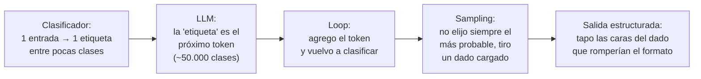

# Planificación: clase introductoria a LLMs y salidas estructuradas

> Estado: borrador v1 (2026-11-10). Público: nivel secundario; se dicta en los laboratorios de la Universidad Nacional de Hurlingham (UNAHUR).
> **Actualización 2026-11-12:** se definió el formato: **taller de 2 horas, todo práctico**, con diapositivas en reveal.js. La primera versión ya está construida: ejercicios en `ejercicios/` (una carpeta por ejercicio) y diapositivas en `clases/`. El recorrido vigente es el del `README.md` de la raíz; la sección 3 de este documento describe el diseño original en dos bloques de 80 minutos.
> **Actualización 2026-11-12 (b):** se repensó la primera parte. Ya no se escriben a mano softmax, temperatura, top-k ni top-p: se delegan a llama.cpp. Los ejercicios son programas completos que se corren y se modifican (`00-preparacion`, `01-tokens`, `02-logits`), y las diapositivas de esa parte son interactivas. El recorrido abre con un clasificador de imágenes (perro, persona, persona disfrazada de perro). La segunda parte (máscara, Outlines, kiosco) falta repensar; los ejercicios 00 a 03 anteriores quedaron en `ejercicios/_anteriores/`.
> **Actualización 2026-11-14:** la segunda parte ya no abre con el «gancho» ni con la pregunta de los dados. Abre con un planteo directo: un LLM no es determinista, cada tanto da una respuesta no esperada, y un programa que lo usa tiene que comprobar lo que devolvió. El ejemplo es clasificar el mensaje de un cliente (`ejercicios/03-clasificar`). El ejercicio 04 se rehízo con el mismo criterio que la primera parte: la máscara ya está escrita, con el ejemplo de la patente, en dos programas completos: `mascara_v1.py`, con un modelo ficticio de 38 tokens, y `mascara_v2.py`, con el modelo real; la versión para completar quedó en `ejercicios/_anteriores/04-mascara`. Los ejercicios 05 y 06 también: programas cortos y completos que usan Outlines directo, sin la carpeta `taller/`. De la versión anterior quedan las dos diapositivas del cierre.
> Lo marcado con **[verificar]** todavía no fue probado en una máquina real.

## 1. Objetivo y restricciones

**Objetivo:** que al terminar, cada estudiante pueda explicar con sus palabras:

1. En qué se parece y en qué se diferencia un clasificador de un LLM.
2. Cómo se elige la próxima palabra (sampling: temperatura, top-k, top-p).
3. Cómo se obliga a un LLM a respetar un formato (salida estructurada) y por qué eso funciona siempre.

**Restricciones de diseño:**

| Restricción | Consecuencia |
|---|---|
| Equipo: computadoras de los laboratorios de la UNAHUR, mejores que una netbook escolar, y se pueden instalar paquetes. Falta conocer procesador y memoria **[verificar]** | Modelos de hasta 1–2 GB sin GPU. Lo liviano sigue siendo prioridad para que el material sirva fuera del laboratorio |
| Hay internet en el aula | Se pueden usar recursos externos, Colab, un sitio en Vercel y un servidor local con el modelo. Las trazas precalculadas quedan como plan B |
| Solo modelos abiertos | Pesos con licencia Apache 2.0 / MIT preferentemente |
| Clase en español | El modelo tiene que entender español (descarta varios modelos chicos) |
| Nivel secundario | Cero álgebra lineal como requisito; cada idea se ve primero sin código |

## 2. Hilo conductor

La idea que une toda la clase:

> **Un LLM es un clasificador que se usa en loop. La salida estructurada es tapar opciones antes de elegir.**



**Ejemplo que atraviesa toda la clase:** un kiosco/rotisería que recibe pedidos por WhatsApp.

- Clasificador: «¿este mensaje es un *pedido*, una *consulta* o un *reclamo*?»
- LLM libre: «respondele al cliente» → texto libre, cada vez distinto.
- LLM estructurado: «mandame dos de carne y una coca» → `{"producto": "empanada de carne", "cantidad": 2}, ...` que un programa puede leer sin romperse.

El mismo mensaje sirve para las tres etapas, así el estudiante solo aprende una idea nueva por vez.

## 3. Estructura de la clase

Pensada en dos bloques de 80 minutos (ajustable, ver preguntas abiertas). Cada tramo sigue el mismo ritmo: **ver** (animación) → **tocar** (applet) → **programar** (notebook, opcional según el curso).

| # | Tramo | Min | Idea central | Ver | Tocar | Programar |
|---|---|---|---|---|---|---|
| 0 | Gancho | 5 | Le pedimos JSON a un modelo 10 veces; algunas veces falla y el programa se rompe. «¿Cómo hago que algo que tira dados cumpla siempre?» | Demo en vivo | — | — |
| 1 | Clasificación | 15 | Entrada → puntajes → probabilidades → etiqueta | Anim. 1 | Applet A1 | NB 01 |
| 2 | De clasificador a LLM | 20 | Tokens; el próximo token como clasificación gigante; loop autorregresivo | Anim. 2 | Applets A2, A3 | NB 02 |
| 3 | Sampling | 20 | Dado cargado; temperatura; top-k; top-p | Anim. 3 | Applet A3 | NB 03 |
| — | *Actividad sin computadora* | 15 | «Somos el LLM»: tarjetas con tokens y dados | — | Papel | — |
| 4 | Salida estructurada | 30 | Máscara sobre los logits; autómata que dice qué tokens valen; de regex a JSON Schema | Anim. 4 | Applet A4 | NB 04, 05 |
| 5 | Mini proyecto | 25 | Extractor de pedidos del kiosco | — | Applet A5 | NB 06 |
| 6 | Cierre | 10 | Formato garantizado ≠ contenido verdadero. Qué garantiza y qué no | — | — | — |

### Actividad sin computadora («Somos el LLM»)

Sirve como plan B total si falla la tecnología y fija la idea mejor que cualquier demo:

- Un grupo recibe una tabla «después de *X* puede venir…» con probabilidades (un modelo de bigramas en papel).
- Tiran un dado para elegir cada palabra → experimentan el sampling.
- Un estudiante hace de **«gramática»**: tiene una regla escrita (por ejemplo «la respuesta tiene que ser un número de dos cifras») y veta tarjetas antes de la tirada → experimentan la máscara.

### Aristas por tópico

**Clasificación vs. LLM**
- Arista conceptual: ambos devuelven una distribución de probabilidad; cambia la cantidad de clases y que el LLM se realimenta.
- Arista práctica: un clasificador da *una* respuesta de un conjunto cerrado; un LLM puede decir cualquier cosa (ventaja y problema).
- Arista crítica: ninguno «sabe»; ambos puntúan opciones.
- Puente al final: salida estructurada con `Literal["pedido", "consulta", "reclamo"]` convierte al LLM de nuevo en un clasificador. El círculo se cierra.

**Sampling**
- Logits → softmax, explicado como «puntajes → porciones de torta».
- Greedy vs. muestreo: por qué elegir siempre el más probable da textos repetitivos.
- Temperatura como «achatar o afilar» la torta; top-k y top-p como «recortar» la torta.
- Reproducibilidad: semilla (por qué la misma pregunta da respuestas distintas).

**Salida estructurada**
- Nivel 1, lista cerrada: solo dejo vivos los tokens de «sí» / «no».
- Nivel 2, regex: un autómata finito recorre estados; en cada estado valen ciertos tokens (ejemplo: un DNI, una fecha, una patente `AA 123 BB`).
- Nivel 3, JSON Schema: lo mismo, con una gramática más grande.
- Diferencia clave: *pedir* el formato en el prompt (puede fallar) vs. *forzarlo* en el sampling (no puede fallar).
- Límite: la máscara garantiza la forma, no la verdad. Un JSON válido puede decir que pediste 400 empanadas.
- Detalle fino (opcional): los tokens no son letras; un token puede cubrir medio campo, por eso hacen falta librerías.

## 4. Herramientas a construir

### 4.1 Applets interactivos (sitio estático)

Con internet y mejores equipos, los applets pueden mostrar un modelo real en vivo. Cada applet funciona con tres fuentes de datos intercambiables:

| Fuente | Qué es | Comentario |
|---|---|---|
| A. Trazas precalculadas | Probabilidades reales guardadas en JSON (KB) | No depende de nada. Plan B y lo primero que se construye |
| B. Servidor local del docente | `llama-server` en una máquina del laboratorio; los applets le piden probabilidades (`n_probs`) y salidas con `json_schema` | Los estudiantes no descargan nada. Falta probar concurrencia y acceso desde el sitio **[verificar]** |
| C. Modelo en el navegador | wllama o Transformers.js | Para seguir probando en casa **[verificar]** |

| Applet | Qué muestra | Fuente |
|---|---|---|
| A1 Clasificador | Escribís un mensaje del kiosco y ves las barras de probabilidad de 3 clases | A |
| A2 Tokenizador | El texto se parte en tokens de colores, con sus IDs | A |
| A3 Ruleta del próximo token | Barras de probabilidad + ruleta; sliders de temperatura, top-k, top-p; botón «girar» y generación paso a paso | A, B |
| A4 Máscara y autómata | Diagrama de estados a la izquierda, barras a la derecha; los tokens inválidos se apagan en cada paso; interruptor «con/sin restricción» | A, B |
| A5 Playground | Editor de esquema + prompt, salida libre vs. estructurada lado a lado | B o C |

Stack sugerido: Vite + TypeScript sin framework pesado, SVG/Canvas (D3 para escalas y transiciones), desplegado en Vercel. Los applets se pueden incrustar en las diapositivas por `iframe`.

Opciones para el modelo en el navegador (fuente C):

- **wllama** (llama.cpp en WASM): usa los mismos GGUF que los notebooks, funciona sin WebGPU. Límite de 2 GB por archivo. El modo multihilo necesita cabeceras COOP/COEP, que en Vercel se configuran en `vercel.json`. No confirmé que exponga logits ni gramáticas GBNF en su API **[verificar]**.
- **Transformers.js** (ONNX Runtime, WASM por defecto, `dtype: "q4"`): da acceso a los logits del modelo, así que la máscara la podemos escribir nosotros en JS (y eso es didáctico). **[verificar]** soporte de logits processors propios.
- **XGrammar** tiene API de JavaScript y se integra con WebLLM, pero WebLLM exige WebGPU; pasa a ser opción si las máquinas del laboratorio lo soportan.

### 4.2 Animaciones estilo 3Blue1Brown

| Opción | Uso | Comentario |
|---|---|---|
| **Manim Community** (Python) | Videos pre-renderizados para las diapositivas | Maduro; el código de las escenas queda en el repo como material extra |
| **manim-web** (TypeScript, MIT) | Animaciones interactivas en el navegador | Joven (~500 estrellas); tiene objetos arrastrables y reproductor. Evaluar con una prueba corta antes de adoptarlo |
| SVG/D3 a mano con la estética 3b1b | Dentro de los applets | Lo más liviano y controlable |

Recomendación: Manim Community para 4 videos cortos (30–60 s) + la misma paleta y tipografía en los applets, para que todo se vea como un solo material.

Escenas:

1. **Clasificador:** un mensaje entra, salen 3 barras, gana una.
2. **Del clasificador al LLM:** las 3 barras se transforman en 50.000; el token elegido vuelve a la entrada (loop).
3. **Sampling:** las barras se enrollan en una ruleta; la temperatura deforma las porciones.
4. **Máscara:** un autómata avanza de estado; en cada paso una cortina tapa las barras inválidas y el resto se renormaliza.

### 4.3 Notebooks y scripts (por duplicado, una sola fuente)

Para tener notebook **y** script sin que se desincronicen: **Jupytext**. La fuente es el `.py` en formato *percent* (`# %%`); el `.ipynb` se genera automáticamente (pre-commit + CI). Se edita un solo archivo.

| # | Tema | Dependencias | Corre en JupyterLite |
|---|---|---|---|
| 01 | Clasificador desde cero: puntajes, softmax, etiqueta | numpy | Sí |
| 02 | Tokens y próximo token con un modelo real | llama-cpp-python | No |
| 03 | Sampling a mano: greedy, temperatura, top-k, top-p | numpy (+ trazas JSON) | Sí |
| 04 | Salida estructurada a mano: máscara con lista cerrada, después autómata para una regex | numpy (+ trazas JSON) | Sí |
| 05 | Lo mismo con Outlines: `Literal`, regex, Pydantic | outlines, llama-cpp-python | No |
| 06 | Mini proyecto: extractor de pedidos del kiosco | outlines | No |

El notebook 04 es el corazón de la clase: ~30 líneas de Python que implementan la máscara. Recién después aparece la librería, para que no sea magia.

Entornos de ejecución:

1. **Local con `uv`** + modelos GGUF: opción principal, porque el laboratorio permite instalar paquetes. Todos los notebooks y scripts, sin cuentas. Dejar todo instalado y los modelos descargados antes de la clase.
2. **Google Colab**: respaldo y opción para seguir en casa; pide cuenta de Google.
3. **JupyterLite** (Python en el navegador, sin cuenta ni instalación): notebooks 01, 03 y 04.

### 4.4 Modelos candidatos

| Modelo | Tamaño aprox. (Q4) | Licencia | Español | Comentario |
|---|---|---|---|---|
| **Qwen3-0.6B** | ~400–500 MB | Apache 2.0 | Sí (multilingüe) | Piso liviano y candidato para el navegador. Una prueba en CPU sin GPU reporta ~35 tokens/s en una PC común |
| **Qwen3-1.7B** | ~1,1–1,4 GB **[verificar]** | Apache 2.0 | Sí | Candidato para el servidor local y los notebooks: mejor español. Medir en el laboratorio **[verificar]** |
| SmolLM2-360M-Instruct | ~260 MB | Apache 2.0 | **No** (solo inglés) | Bueno para mostrar «modelo chico» pero no para la clase en español |
| SmolLM2-135M-Instruct | ~100 MB | Apache 2.0 | No | Útil para el navegador (fuente C) si se acepta inglés |
| Gemma 3 270M | ~250 MB | Términos de Gemma (no es licencia OSI) | **[verificar]** | El más chico de su familia; la licencia choca con «open source» estricto |
| LFM2-350M | ~250 MB | **[verificar]** | **[verificar]** | Un blog lo reporta mejor que Qwen3-0.6B; revisar licencia |

Un hallazgo que juega a favor: con salida estructurada, un modelo muy chico que «habla mal» igual produce JSON válido. Es una demostración potente («el modelo es flojo, pero el formato no falla nunca») y a la vez muestra el límite (el contenido puede estar mal).

Runtime en Python: **llama-cpp-python + GGUF** (liviano; usa el mismo archivo que el servidor local). En Colab también sirve `transformers`.

### 4.5 Librerías de salida estructurada

| Librería | Rol en la clase | Notas |
|---|---|---|
| **Outlines** | La que usan los estudiantes | API muy legible: `model(prompt, Literal[...])`, `model(prompt, MiClasePydantic)`; también regex y gramáticas. Soporta transformers y llama.cpp. La API cambió en la v1 (`outlines.from_transformers(...)`); fijar versión en el repo |
| **XGrammar** | Se menciona como «el motor de los servidores» | Motor por defecto en vLLM y SGLang; API en Python, C++, JS y Swift; XGrammar-2 salió en mayo de 2026 |
| **llguidance** | Se menciona | En Rust; integrable en llama.cpp al compilar; muy buena cobertura de JSON Schema |
| **GBNF de llama.cpp** | Plan B sin dependencias extra | llama.cpp ya trae gramáticas y conversión desde JSON Schema (subconjunto) |

Mensaje para la clase: todas hacen lo mismo que el notebook 04 (enmascarar tokens según una gramática); cambian la velocidad y qué gramáticas soportan.

### 4.6 Diapositivas

Recomendación: **reveal.js dentro del repo**, publicado en Vercel junto con los applets. Ventajas: los applets y videos se incrustan directo, se versiona con git y se exporta a PDF. Alternativa: PowerPoint/Google Slides con videos incrustados y enlaces a los applets (más familiar, pero sin interactividad dentro de la diapositiva).

## 5. Estructura del repositorio

```
.
├── README.md                # cómo usar el material (docente / estudiante)
├── docs/                    # planificación, guía docente, actividad en papel (PDF imprimible)
├── clases/                  # diapositivas (reveal.js)
├── web/                     # applets (Vite + TS) → Vercel
│   └── public/trazas/       # logits precalculados (JSON)
├── animaciones/             # escenas de Manim + videos renderizados
├── ejercicios/
│   ├── scripts/             # fuente: .py formato percent
│   ├── notebooks/           # generados con Jupytext
│   └── soluciones/
├── herramientas/            # generar trazas, descargar modelos, levantar el servidor local
└── .github/workflows/       # build de Pages, JupyterLite, sincronía Jupytext, tests de notebooks
```

## 6. Etapas de trabajo

| Etapa | Entregable | Criterio de salida |
|---|---|---|
| **0. Pruebas de factibilidad** | Mediciones, no producto | (a) Modelos en una máquina parecida a las del laboratorio: tokens/s y RAM. (b) Outlines + llama.cpp con prompts en español. (c) `llama-server` atendiendo a varios navegadores a la vez. (d) Modelo en navegador sobre Vercel. (e) Escena de prueba en manim-web |
| **1. Núcleo sin modelo** | Applets A2–A4 con trazas, notebooks 01/03/04, actividad en papel | La clase completa se puede dar aunque se caiga internet |
| **2. Modelo real** | Notebooks 02/05/06, script de instalación, servidor local, applet A5 | Funciona en el laboratorio con un curso completo conectado |
| **3. Narrativa** | Animaciones, diapositivas, guía docente | Ensayo cronometrado |
| **4. Prueba piloto** | Clase con un grupo chico | Ajustes de tiempos y dificultad |

El orden está pensado para que al final de la etapa 1 ya exista una clase que se puede dar, aunque todo lo demás falle.

## 7. Riesgos

| Riesgo | Mitigación |
|---|---|
| El servidor local no aguanta a todo el curso | Salidas cortas (~30 tokens); trabajo en grupos; modelo más chico; trazas como respaldo |
| Se cae internet durante la clase | Applets con trazas servidos desde la máquina docente por red local; actividad en papel |
| La instalación en cada máquina consume tiempo de clase | Script de instalación de un solo comando, corrido antes; modelos ya descargados; Colab como respaldo |
| Recursos externos en inglés | Proyectados y guiados por el docente; subtítulos traducidos; los applets propios cubren lo mismo en español |
| Los estudiantes no programan | La columna «tocar» alcanza para los tres objetivos; «programar» es extensión |
| Cambios de API en las librerías | Versiones fijadas + CI que ejecuta los notebooks |
| Modelo chico en español escribe mal | Convertirlo en contenido (ver 4.4); trazas generadas con un modelo mejor |

## 8. Preguntas abiertas

1. ~~**Duración y formato**~~ Resuelto: taller de 2 horas, todo práctico.
2. **Conocimientos previos:** ¿los estudiantes ya programan en Python (escuela técnica / orientación informática) o es su primer contacto?
3. **Laboratorio:** ¿qué procesador, memoria y sistema operativo tienen las máquinas? ¿Cuántos estudiantes por máquina?
4. ~~**Diapositivas**~~ Resuelto: reveal.js en el repo (`clases/`).
5. **Alcance:** ¿material para dar vos una vez, o un recurso reutilizable por otros docentes (cambia cuánto invertir en guía docente)?

## 9. Recursos externos de apoyo

Casi todo está en inglés. Los marcados **[verificar]** están citados de memoria; falta abrir el enlace.

| Recurso | Qué es | Tramo |
|---|---|---|
| [Teachable Machine](https://teachablemachine.withgoogle.com) **[verificar]** | Entrenar un clasificador con la cámara, sin código | Clasificación |
| [3Blue1Brown: Large Language Models explained briefly](https://www.3blue1brown.com/topics/neural-networks) | Video de 8 min. No confirmé doblaje al español | De clasificador a LLM |
| [Transformer Explainer](https://poloclub.github.io/transformer-explainer/) | GPT-2 en el navegador con control de temperatura | LLM y sampling |
| [Tiktokenizer](https://tiktokenizer.vercel.app) **[verificar]** | Ver tokens reales de distintos modelos | Tokens |
| [LLM Visualization](https://bbycroft.net/llm) | Recorrido 3D por adentro de un modelo; para quien quiera más | Extensión |
| [Regexper](https://regexper.com) **[verificar]** | Dibuja una regex como diagrama; previa al applet A4 | Salida estructurada |
| [Documentación de Outlines](https://dottxt-ai.github.io/outlines/) **[verificar]** | Referencia para notebooks 05 y 06 | Salida estructurada |
| [Efficient Guided Generation for LLMs](https://arxiv.org/abs/2307.09702) **[verificar]** | Artículo que dio origen a Outlines; para el docente | Salida estructurada |
| [Grandes modelos de lenguaje, con un mínimo de matemáticas](https://www.understandingai.org/p/grandes-modelos-de-lenguaje-llm-una) | Artículo de divulgación en español | Cierre |
| [Think Like AI](https://sigcse2026.sigcse.org/details/sigcse-ts-2026-Papers/77/Think-Like-AI-Hands-On-Exploration-of-Sampling-Parameters-and-Prompts-for-Middle-Sch) | Experiencia de aula (10–14 años) sobre sampling; referencia didáctica | Sampling |
| [Exploring LLMs through interactive Python activities](https://arxiv.org/pdf/2501.05577) | Actividades en notebooks con GPT-2 | Notebooks |

## 10. Fuentes

- Outlines: https://github.com/dottxt-ai/outlines
- XGrammar: https://github.com/mlc-ai/xgrammar
- llguidance en llama.cpp: https://sources.debian.org/src/llama.cpp/8461%2Bdfsg-1/docs/llguidance.md
- Gramáticas GBNF: https://raw.github.com/ggerganov/llama.cpp/master/./grammars/README.md
- JSONSchemaBench (comparación de motores): https://arxiv.org/html/2501.10868v3
- Backends de salida estructurada en vLLM: https://discuss.vllm.ai/t/general-questions-on-structured-output-backend/1444
- wllama: https://github.com/ngxson/wllama
- Transformers.js: https://huggingface.co/docs/transformers.js/index
- manim-web: https://github.com/maloyan/manim-web
- Transformer Explainer: https://arxiv.org/pdf/2408.04619
- Think Like AI (SIGCSE 2026, sampling para 11–14 años): https://sigcse2026.sigcse.org/details/sigcse-ts-2026-Papers/77/Think-Like-AI-Hands-On-Exploration-of-Sampling-Parameters-and-Prompts-for-Middle-Sch
- Exploring LLMs through interactive Python activities: https://arxiv.org/pdf/2501.05577
- JupyterLite en GitHub Pages: https://jupyterlite.readthedocs.io/en/stable/quickstart/deploy.html
- JupyterLite para talleres: https://www.zonca.dev/posts/2026-05-18-jupyterlite-no-server-needed
- LLMs chicos en CPU: https://itsfoss.com/testing-local-llms-without-gpu
- SmolLM2-360M GGUF: https://huggingface.co/nyaaorick/SmolLM2-360M-Instruct-GGUF
- Cabeceras COOP/COEP en Vercel: https://vercel.com/guides/fix-shared-array-buffer-not-defined-nextjs-react
- Servidor de llama.cpp (n_probs, json_schema): https://github.com/Mozilla-Ocho/llamafile/blob/6423228b5ddd4862a3ab3d275a168692dadf4cdc/llama.cpp/server/README.md
